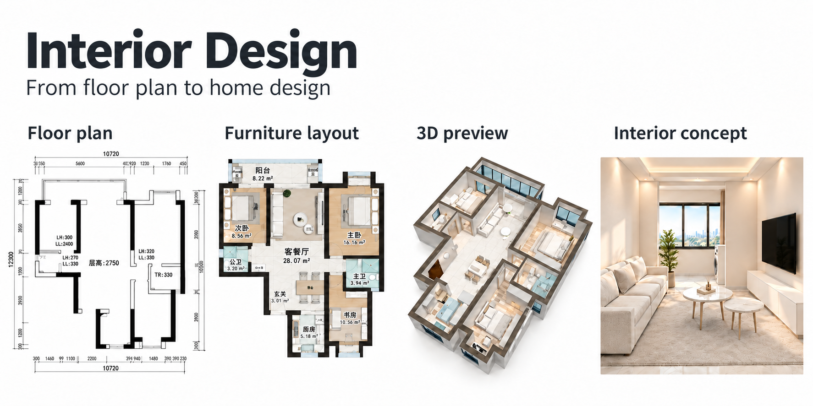
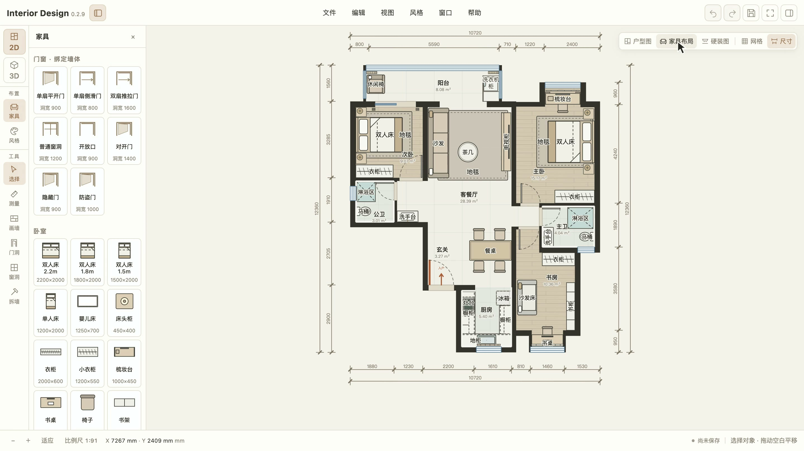
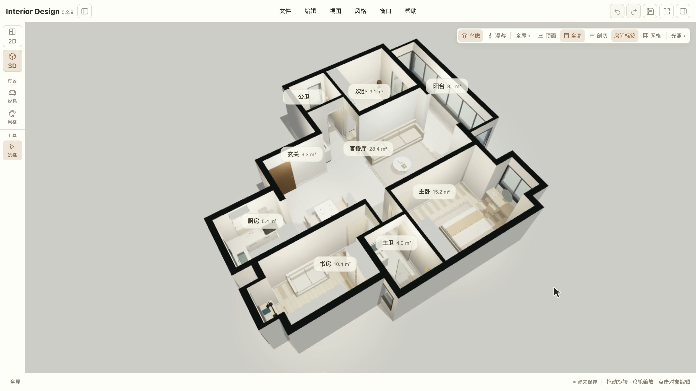

# Interior Design

English | [中文](README.zh.md)

## Overview

An Agent Skill for homeowners and renovation design teams. Start with one floor-plan image to plan furniture, choose an interior style, and create an editable 2D/3D workbench with coordinated interior concept images.

Furniture layouts and style references are optional. The floor plan, furniture drawings and 3D preview use the same scheme.

Version: 0.2.14 (local release candidate).

## Preview



| 2D drawings and furniture editing | 3D views and display modes |
| --- | --- |
| [](https://chemny.github.io/assets/floorplan/demos/jujian-workbench/2d-operations.mp4) | [](https://chemny.github.io/assets/floorplan/demos/jujian-workbench/3d-operations.mp4) |
| Switch drawings, rotate and move furniture, check dimensions and undo edits. | Orbit, ceiling, section, room-focus and day/night views. |

### Whole-home tour

https://github.com/user-attachments/assets/51f3b6ef-f170-41ec-b54c-65b9fc957abf

[Explore the full case](https://chemny.github.io/project-interior-design.html)

## Features

| Capability | What it helps you do |
| --- | --- |
| Start from one plan | Review rooms, dimensions, walls, windows and access before designing. |
| Furniture planning | Propose wall-backed furniture, usable passages, door clearance and curtain space for your household. |
| Visual style selection | Compare nine interior style directions in one image before choosing. |
| Editable 2D/3D workbench | Edit furniture, doors, eligible walls and finishes, then inspect the same scheme from above or in a walkthrough. |
| Precise editing | Copy objects, insert components from a context menu, snap alignment, measure and undo/redo. |
| Save and confirm | Save, export and resume editing schemes, and record stage confirmations. |
| Coordinated interior concepts | Generate room and whole-home views using the confirmed layout and style, then review differences. |
| Stage cleanup | Clean up obsolete media after confirmation, retain a recovery path and protect current work. |
| Local delivery | Provide the workbench, drawings, scheme data and selected images with a file index and integrity checks. |
| Optional camera preflight | Plan routes, preview cameras and choose standard or high-quality rendering; add narration and subtitles after video approval. |

For concept design; not a replacement for site measurements, structural assessment or construction drawings.

## Installation

Send this request to your Agent:

```text
Install this Skill: https://github.com/chemny/visualize-floorplans
Check the core environment first. Explain any missing dependencies and get my confirmation before installing them, then verify that the Skill works.
```

Core features require Python 3.11 or newer and a modern browser. Image and tour tools are configured when needed. See [runtime guidance](references/platform-runtime.md) for client and operating-system support.

## Quick Start

The workflow: **review the plan and needs → arrange furniture → choose a style and deliverables**.

Attach a floor-plan image and ask:

```text
Help me design this home. I have no furniture layout or style reference.
Check the plan, suggest a practical layout and show style options, then make an editable 2D/3D workbench and interior concepts after confirmation.
```

## Usage Examples

### Adjust a furniture layout

```text
Three people will live here. Make the study a guest room too, keep the main passages clear, and show the proposed layout in the workbench.
```

### Choose finishes visually

```text
Show nine styles for the confirmed living/dining layout in one comparison image, using the same eye-level view. Recommend one and explain why.
```

### Continue editing a scheme

```text
I have saved my edits in the local workbench. Read that saved scheme and continue with the confirmed layout.
```

Bring the saved workbench or scheme file when continuing on another device.

### Make a tour when needed

```text
Create a continuous homeowner tour from this confirmed scheme. Show the main rooms clearly and keep turns smooth.
```

Confirm and preview the route and camera before creating the video; add narration after video approval. Tours support subtitles, a route map and chapter navigation.

[Usage guide](references/guided-user-workflow.md) · [Reference cases](assets/reference-cases/)

## License

Original code and documentation use [MIT](LICENSE). See [third-party notices](THIRD_PARTY_NOTICES.md) for upstream and dependency licenses. Case materials retain their respective rights.

Maintained by [chemny](https://github.com/chemny) · [Report an issue](https://github.com/chemny/visualize-floorplans/issues)
