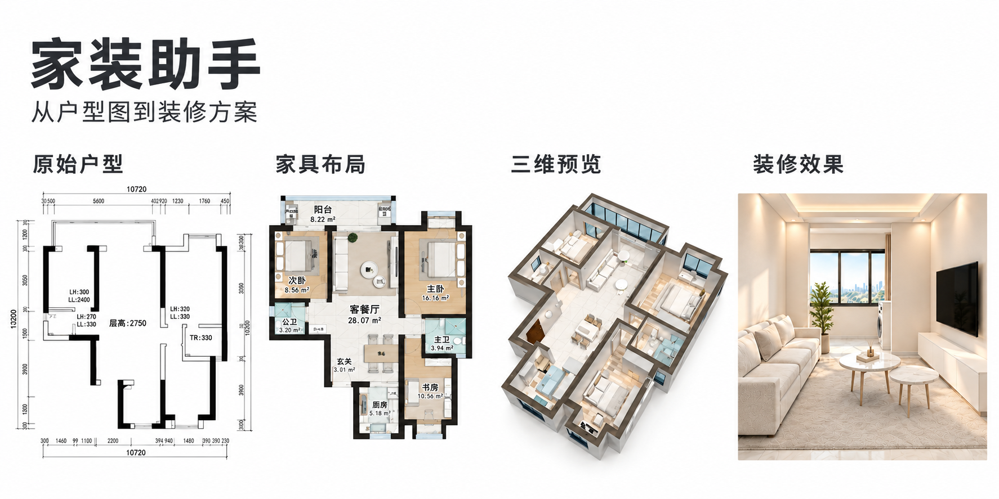
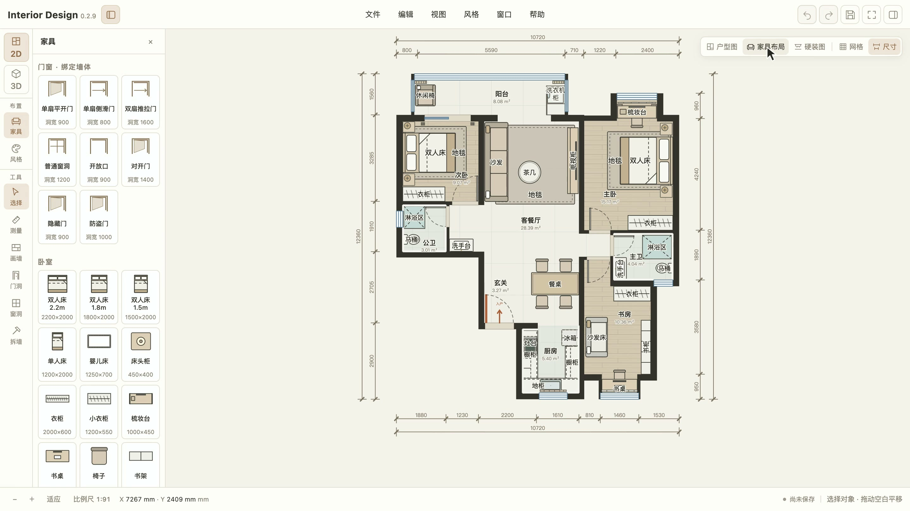
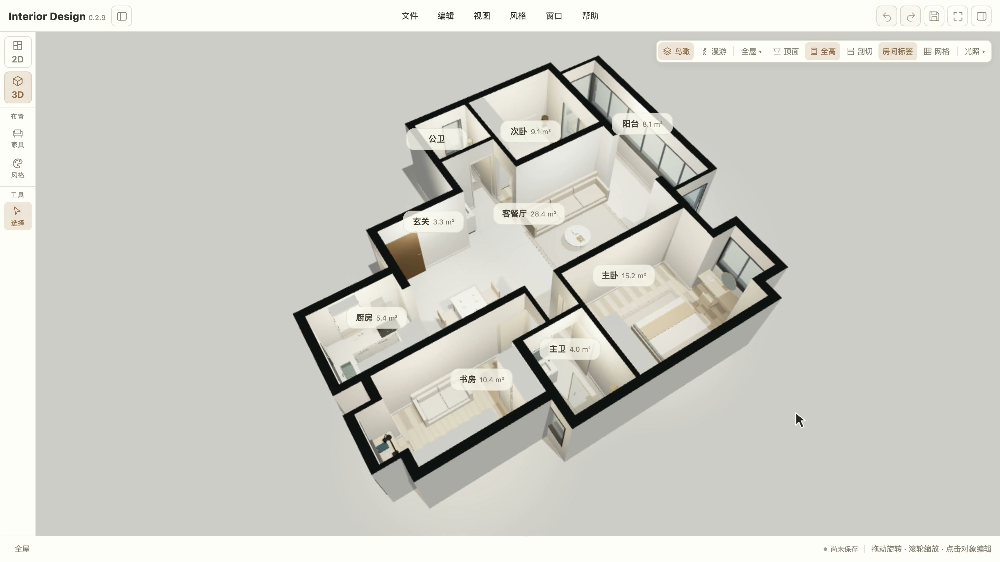

# 家装助手 · Interior Design

[English](./README.md) | 中文

## 项目简介

这是一个面向房主和装修设计团队的 Agent Skill，也就是供 Agent 执行的装修设计技能。从一张户型图开始，核对户型、设计家具布局、看图选装修风格，最后获得可编辑的 2D/3D 工作台和配套装修效果图。

家具布局图、风格参考图都不是必需材料。Agent 读取图上能看清的尺寸，只询问影响设计的重要疑点；缺失尺寸不会冒充实测数据。户型图、家具布局图和三维预览使用同一套方案。

## 效果预览



这是一张流程示意图；AI 装修效果图与可编辑三维预览是不同的输出。

### 工作台操作录屏

| 二维图纸与家具编辑 · 15秒 | 三维观察与显示效果 · 20秒 |
| --- | --- |
| [](assets/demos/jujian-workbench/2d-operations.mp4) | [](assets/demos/jujian-workbench/3d-operations.mp4) |
| 切换户型图、家具布局和硬装图；旋转、拖动家具，打开尺寸入口并撤销。 | 前 15 秒展示白天鸟瞰、顶面、剖切、俯视和房间聚焦；后 5 秒切换夜景并旋转。 |

点击图片查看高清配乐录屏（2880 × 1620，30 fps）。两段均来自家装助手工作台的实际操作。

配乐由 [YuE2-3B（m-a-p）](https://huggingface.co/m-a-p/YuE2-3B) 本地生成，采用 [ahmadw 的 MLX 转换](https://huggingface.co/ahmadw/YuE2-3B-MLX)及 [ddalcu 的 MLX-Serve 8-bit 模型](https://huggingface.co/ddalcu/YuE2-3B-MLX-Serve-8bit)。

[查看内置「居间 · 香槟珍珠」案例](assets/reference-cases/jujian-champagne-pearl/index.html)：原始参考、13 张效果图、可编辑工作台、图纸和 56 秒导览。安装后让 Agent 打开本地案例；GitHub 文件页面不能执行 HTML。案例保留的效果图、导览与当前示例工作台存在灯光和材质差异，详见[案例说明](assets/reference-cases/jujian-champagne-pearl/README.md)。

[查看已确认的 57 秒房主导览](assets/reference-cases/dimensioned-homeowner-tour/index.html)：最终视频、路线与镜头配置及简要核验记录。用户定稿确认与尚未完成的内部连续播放审阅分别记录。

## 核心功能

| 能力 | 它能帮你做什么 |
| --- | --- |
| 从一张户型图开始 | 设计前核对房间、尺寸、墙体、门窗和入口关系。 |
| 家具布局建议 | 按居住需求安排靠墙家具、通道、开门净空和窗帘留位。 |
| 看图选风格 | 先在一张图中比较九种室内装修风格，再做选择；需要可用的生图工具。 |
| 可编辑 2D/3D 工作台 | 修改家具、门、可拆改墙体和材质，鸟瞰或漫游查看同一方案。 |
| 精细编辑 | 复制物件、右键插入组件、对齐吸附、测量和撤销重做。 |
| 保存与确认 | 本地项目服务直接接收保存和阶段确认；独立 HTML 支持单独保存、导出。 |
| 配套装修效果图 | 根据确认的布局、风格制作房间及全屋效果，逐图检查差异。 |
| 阶段性清理 | 检查失效素材和引用，经批次确认后备份隔离；不后台自动删除。 |
| 本地交付 | 汇总工作台、图纸、方案数据和已确认效果图，附索引与文件校验信息。 |
| 按需制作导览 | 先确认路线与镜头，默认H5渲染，或选择Blender高质量渲染；视频确认后再合成讲解。 |

这是概念设计工具，不提供实测 CAD、结构安全评估或施工文件。墙体性质不明确时，拆改建议需要先核实。视频、Blender 都不是必选步骤；不包含装修报价。

## 安装

技能版本：**0.2.14**。

### 配置要求

先由 Agent 准备基础环境，生图和视频功能等需要时再配置。

| 项目 | 要求 |
| --- | --- |
| Agent 客户端 | 已在 Codex 使用；面向 Claude Code、OpenClaw 设计，这两者尚未实测。 |
| 基础运行环境 | Python 3.11 或更新版本；工作台需要现代浏览器。 |
| 操作系统 | macOS工作台与媒体流程；Windows可作为远程Blender渲染主机。其他客户端仍需按环境核验。 |
| 装修效果图 | 可用且已授权、支持参考图输入的生图或图像编辑工具。 |
| 标准视频 | 已有Node.js、Playwright、Chrome/Chromium和FFmpeg/ffprobe。 |
| Blender视频 | 渲染主机需Blender 5.2兼容接口；支持本地或已有SSH的Windows远程主机。 |
| 讲解与音乐 | 可用的本地或外部语音工具，以及已获授权的声音与音乐素材。 |
| 局部闪烁诊断 / H3放大 | 按需配置OpenCV，或已有远程ComfyUI节点和模型；不是基础依赖。 |

### 快速安装

把这段话发给你的 Agent：

```text
帮我安装这个 Skill：https://github.com/chemny/visualize-floorplans
先检查基础环境；缺少依赖时说明安装方案，经我确认后再安装。安装后检查能否发现和使用，视频功能等我需要时再配置。
```

Agent 应说明哪些已经安装、可以使用，还有哪些工具或权限缺失。详细要求见[运行环境说明](references/platform-runtime.md)。

## 快速开始

上传一张户型图，然后说：

```text
帮我设计这个家。我没有家具布局图，也没有风格参考。
先核对户型，建议实用的家具布局，并给我看装修风格选项；确认后制作可编辑的 2D/3D 工作台和装修效果图。暂不做视频。
```

## 使用示例

### 调整家具布局

```text
家里住三个人，书房兼客卧。请保证主要过道通畅，在工作台里展示建议的家具布局。
```

### 看图选装修风格

```text
用已确认的客餐厅布局，在一张对比图上展示九种风格，保持同一个人眼高度视角。推荐一种，并说明原因。
```

生成效果图需要上述可选生图工具；工作台换配色不能替代室内效果图。

### 接着工作台修改继续做

```text
我已经在本地工作台保存了修改。请读取保存后的方案，按确认布局继续。
```

直接读取使用本地项目服务。独立 HTML 的修改另存于浏览器；切换环境时，需要带走保存后的 HTML 或方案文件。

### 需要时再做导览

```text
根据这套确认方案，制作连续的房主导览。各主要房间要看清楚，转弯平缓。
```

参观制作固定为四步：

1. **路线与镜头**：在户型图上确认完整进出路线、朝向和各房间时间。
2. **镜头预演**：播放同源实时三维，检查构图、转场、遮挡和观看节奏。
3. **视频审阅**：生成所选方式的静音视频，完整播放后确认。
4. **讲解成片**：按已确认画面的时间轴准备配音、短句字幕和背景音乐，再合成。

| 视频方式 | 适合的需求 | 所需工具 |
| --- | --- | --- |
| 标准渲染（默认） | 快速看布局和运镜 | 浏览器工具与FFmpeg，无需Blender |
| Blender高质量渲染 | 更细致的材质、窗光和阴影 | 渲染主机安装Blender，可使用已有远程GPU |

两种方式共用确认后的路线。观看页面和视频不需要安装Blender。
Blender先确认静态样板，再检查门洞、卫浴、窗景等动态短样，之后渲染整片。
远程方式在远端渲染并编码，只取回视频、报告及少量代表帧。

第三步可选择做视频放大短样；放大不保证增加真实细节，不会自动处理整片。
生成式装修处理是另一项可选功能，需指定现有工具并检查结构变化。

配音内容跟随实际镜头，不按房间套用同一段介绍；背景音乐使用固定音量参数。
网页可切换配音、音乐和字幕，路线图与章节列表同步定位。
下载版可包含可选字幕和独立SRT；网页黑描边不表示已烧录进视频。

视频更换后需重新确认该版本，才继续配音合成。详见[双渲染流程](references/tour-render-branches.md)、[四步页面](references/tour-presentation-pages.md)和[执行与交付](references/production-execution-and-delivery.md)。

## 工作原理

集中进行三轮决策：**户型与核心需求 → 家具布局 → 看图选风格与输出范围**。Agent 在每轮内完成细化和自查，将重要问题与推荐方案集中提出，最后汇总成果供用户验收。

| 组件 | 职责 |
| --- | --- |
| 技能流程与参考规则 | 核对原图、引导决策、应用家具布局规则并记录确认。 |
| 内置 H5 引擎 | 用同一套方案联动二维图纸、三维几何、材质和家具。 |
| Python 规划与校验工具 | 构建工作台、检查布局约束、整理交付文件。 |
| 本地项目服务 | 接收保存内容，检测版本冲突，记录阶段确认。 |
| 可选图像 / 视频工具 | 根据确认方案制作效果图或按需视频；技能不附带账号、凭证。 |
| 内置参考案例 | 展示具体成果，不把案例户型和选择强加给新项目。 |

可以单独提出某项任务。墙体、家具、材质变化，只使依赖它们的确认失效；文件检查通过不代表用户已认可。详见[引导流程](references/guided-user-workflow.md)、[质量门禁](references/h5-quality-gates.md)和[保存确认机制](references/project-save-confirm.md)。

清理边界详见[阶段性清理说明](references/stage-cleanup.md)。

## 目录结构

```text
SKILL.md                 Agent 执行说明
assets/h5/               工作台引擎、源码、运行库和空白模板
scripts/                 规划、布局检查和项目服务
scripts/production/      H5 构建、导出、录制和可选 Blender 工具
agents/                  Agent 入口配置
references/              设计、交互、质量与交付规则
assets/reference-cases/  精选示例素材和成果
requirements.txt         Python 绘图依赖
THIRD_PARTY_NOTICES.md    上游与依赖声明
CHANGELOG.md              版本记录
README.md / README.zh.md  英文 / 中文介绍
LICENSE                  原创内容许可
```

安装包含技能资源与参考案例，不会配置可选生成服务。详见[工具与案例格式](references/h5-tools-and-case-schema.md)、[家具布局规则](references/furniture-placement-principles.md)和[验收交付](references/h5-acceptance-and-handoff.md)。

## 许可

原创代码与文档使用 [MIT](LICENSE)。改编的户型工作台部分保留上游 [MIT 声明](assets/h5/FLOORPLAN-REFERENCE-LICENSE.txt)。Three.js 等依赖保留自身许可，详见[第三方说明](THIRD_PARTY_NOTICES.md)；这些条款不改变外部服务及第三方素材的权利归属。

## 关于我

由 [chemny](https://github.com/chemny) 维护。问题和建议可以提交到[仓库 Issues](https://github.com/chemny/visualize-floorplans/issues)。

## 工具检查

基础环境：`python scripts/check_environment.py`。
视频等可选能力使用 `python scripts/production/h5.py doctor --for FEATURE`，
其中FEATURE可选video、blender、remote、quality或delivery。
工具路径、远程主机、采样、帧率和音轨在案例中配置，缺少时提示，不自动安装。
详见[运行环境说明](references/platform-runtime.md)。
